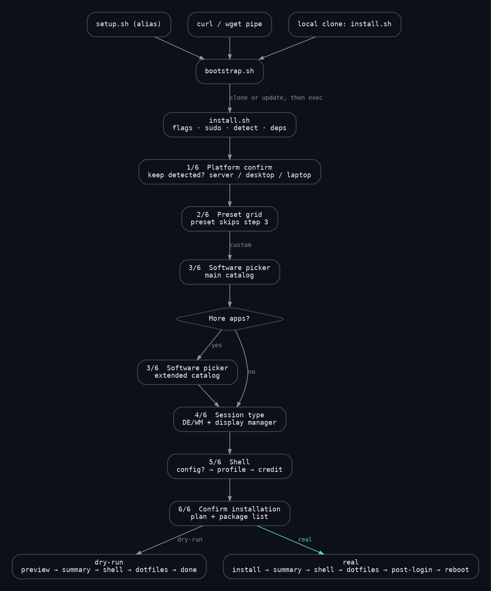

<div align="center">


# os-configs

**Post-install setup for Linux**

Run one command on a booted system. Select a preset or choose your own apps, session, shell, and dotfiles. The installer does not change disks, bootloaders, or live media.

Supports Arch, Debian, Ubuntu, Fedora, and common derivatives. Targets server, desktop, and laptop.

[Quick start](#quick-start) · [Options](#options) · [Flow](#flow) · [Customization](#customization) · [Testing](#testing) · [Scope](#scope)

</div>

---

<div align="center">



</div>

## Quick start

```bash
bash <(curl -fsSL https://raw.githubusercontent.com/4ngel2769/os-configs/main/bootstrap.sh)
```

Run as a normal user with `sudo`. Do not run as root. Over SSH, use `ssh -t` to open the picker.

Bootstrap clones the repo to `~/.os-configs`, checks dependencies, then starts `install.sh`. A local clone works with `./install.sh`. The `setup.sh` alias delegates to `bootstrap.sh` for older links.

The bundled Go picker renders every menu page. Gum is optional. Bootstrap verifies the `jq` binary with the upstream SHA-256 list. Set `OS_CONFIGS_SKIP_CHECKSUM=1` to skip that check.

## Options

| Flag | Effect |
|------|--------|
| `--auto` | Non-interactive run. Keeps detected platform and selects the first preset. |
| `--dry-run` | Runs the full flow and prints the plan. Makes no system changes. |
| `--ask-de-wm` | Prompts for DE/WM and display manager even in a preset. |
| `--skip-dotfiles` | Skips dotfile backup and deploy. |
| `--skip-postlogin` | Skips the one-shot post-login service. |
| `--skip-reboot` | Skips the reboot prompt. |
| `--validate-user` | Validates `data/user/registry.json` and exits. |
| `--help` | Prints usage. |

```bash
wget -qO- https://raw.githubusercontent.com/4ngel2769/os-configs/main/bootstrap.sh | bash -s -- --dry-run
```

| Variable | Purpose |
|----------|---------|
| `OS_CONFIGS_REPO` | Clone URL. Default: this repository. |
| `OS_CONFIGS_DIR` | Clone path. Default: `~/.os-configs`. |
| `OS_CONFIGS_REF` | Branch or tag. Default: `main`. |
| `OS_CONFIGS_ASK_DE_WM` | Set to `1` for the effect of `--ask-de-wm`. |
| `OS_CONFIGS_FORCE_PLATFORM` | Override detection. Values: `server`, `desktop`, `laptop`. |
| `OS_CONFIGS_SKIP_CHECKSUM` | Set to `1` to skip SHA-256 verification. |

## Flow

The installer runs six steps. Each step uses one picker page with the same header, step counter, and Back/Continue footer.

1. **Platform.** Keep the detected platform or select server, desktop, or laptop.
2. **Preset.** Select a curated bundle or Custom.
3. **Software.** In Custom mode, select apps by category. An optional second catalog follows.
4. **Session.** Select the DE or WM and the display manager.
5. **Shell.** Select zsh, bash, or fish. An optional profile adds a theme and plugins.
6. **Confirm.** Review the package list, then install.

After step six, the installer writes a summary, applies the shell, deploys dotfiles, schedules the post-login prompt, and offers a reboot. Dotfile conflicts move to `~/.os-configs-backup/<timestamp>/` before Stow runs.

Presets cover server (minimal, clean, everything) and desktop or laptop (minimal, workstation, creator, gaming when the GPU qualifies). Custom mode is always available.

Read [docs/flow.md](docs/flow.md) for the page list, picker modes, and key map.

## Customization

Add apps or override packages in [ADD-APPS.md](ADD-APPS.md). Per-machine overlays live in `data/user/`. Validate overlays with `./install.sh --validate-user`.

Change page strings and theme colors in `data/tui.json`.

## Testing

```bash
bash test/smoke.sh
./test/run-in-container.sh ubuntu
```

`smoke.sh` checks shell syntax, JSON, registry entries for all four families, preset references, entrypoint help, detection, and picker binaries. `run-in-container.sh` validates presets and runs a dry install in a distro container.

## Scope

The OS must be installed and bootable before you run this tool.

The installer does not do the following:

- Partition disks or plan mounts.
- Install or repair a bootloader.
- Build live USB media or installer ISOs.
- Replace Calamares, Anaconda, Ubiquity, or archinstall.
- Image machines or fleets. `--auto` repeats one profile; it does not image hosts.
- Manage dual-boot or Windows boot entries.

A future custom ISO could run a normal distro installer and launch os-configs on first boot. ISO composition and live-session work are separate tasks.
