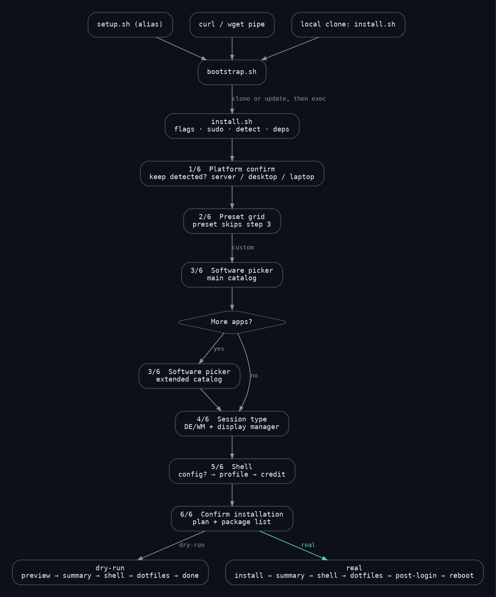
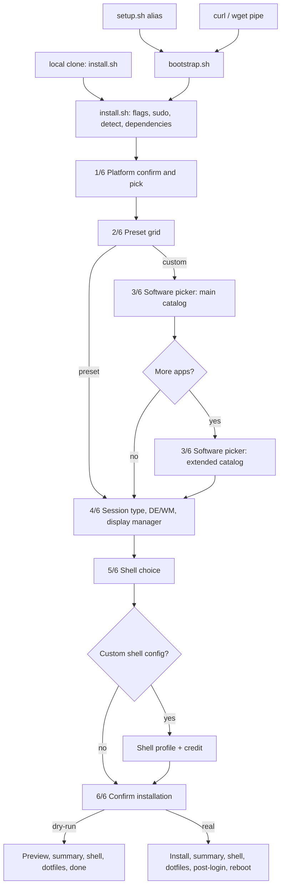

# os-configs — flow and pages

The installer is a six-step wizard. Every interactive decision is a page from `os-configs-picker` (Bubble Tea + lipgloss) with the same header, step counter, footer, and keys. Bash supplies page data as JSON and reads the answer from a result file.



A compact terminal rendering is in [flow-terminal.png](flow-terminal.png). Both images come from the current flow. The chart source is [flow.dot](flow.dot); regenerate it with `dot -Tpng -Gdpi=130 docs/flow.dot -o docs/flow.png`.

```
  setup.sh (alias) ──► bootstrap.sh ◄── curl / wget pipe
                            │  clone or update, then exec
                            ▼
                       install.sh
                  flags · sudo · detect · dependency page
                            │
                            ▼
                flow_run_entry(auto)      step N / 6
      ┌────────────────────────────────────────────────┐
      │ 1/6  Platform confirm → platform pick          │
      │ 2/6  Preset grid                               │
      │ 3/6  Custom: software picker → "more apps?" →   │
      │      extended picker      (preset: skipped)    │
      │ 4/6  Session type → DE/WM → display manager    │
      │ 5/6  Shell → custom config? → profile → credit │
      │ 6/6  Confirm installation (plan + packages)    │
      └────────────────────┬───────────────────────────┘
                           ▼
        dry-run: preview → summary → shell → dotfiles → done
        real:    install → summary → shell → dotfiles → post-login → reboot
```



Back on any page returns to the previous step. `q` quits. All pages share `↑↓` move, `Tab` footer, `Enter` continue, `b`/`Esc` back. The software picker adds `Space` toggle and `c` continue.

## Pages

| Step | Page | Picker mode | Content |
|------|------|-------------|---------|
| — | Dependencies | `flow` (dialog) | Missing tools and system packages |
| 1 | Platform confirm | `flow` (dialog) | Keep detected platform? Yes/No/Back |
| 1 | Platform pick | `flow` (list) | Server, Desktop, Laptop |
| 2 | Preset grid | `--presets` | Preset cards + Custom |
| 3 | Software picker | `--catalog` | Categories pane, apps pane, Back/Continue |
| 3 | More apps | `flow` (dialog) | Yes, No, Back |
| 4 | Session type | `flow` (list) | Desktop environment or Window manager |
| 4 | DE / WM list | `flow` (list) | Detected from `data/de-wm.json` |
| 4 | Display manager | `flow` (list) | Default for the chosen session |
| 5 | Shell choice | `flow` (list) | zsh, bash, fish |
| 5 | Shell config | `flow` (dialog) | Apply a themed profile? |
| 5 | Shell profile | `flow` (list) | Profiles with credits |
| 5 | Credit | `flow` (info) | Profile description and credit link |
| 6 | Confirm plan | `flow` (dialog) | Detection summary and full package list |
| end | Dotfiles | `flow` (dialog) | Back up and deploy? |
| end | Reboot | `flow` (dialog) | Reboot now? |

Every page carries the distro badge, arch, platform and GPU line in the header, plus `Step N / 6` with a progress row. Theme and strings live in `data/tui.json`.

## Rendering without gum

The picker binary renders all of the above with lipgloss: rounded borders, glyphs (`◉ ○ ▸ ← ⏎`), lists, two-pane layouts and dialog overlays. Gum is optional and is no longer installed by the dependency step; it is only a last-resort fallback for the few `gum choose` prompts in the no-picker path. Without either tool, status output falls back to plain text. Non-interactive runs print plain lines instead of a spinner, so logs stay readable.
